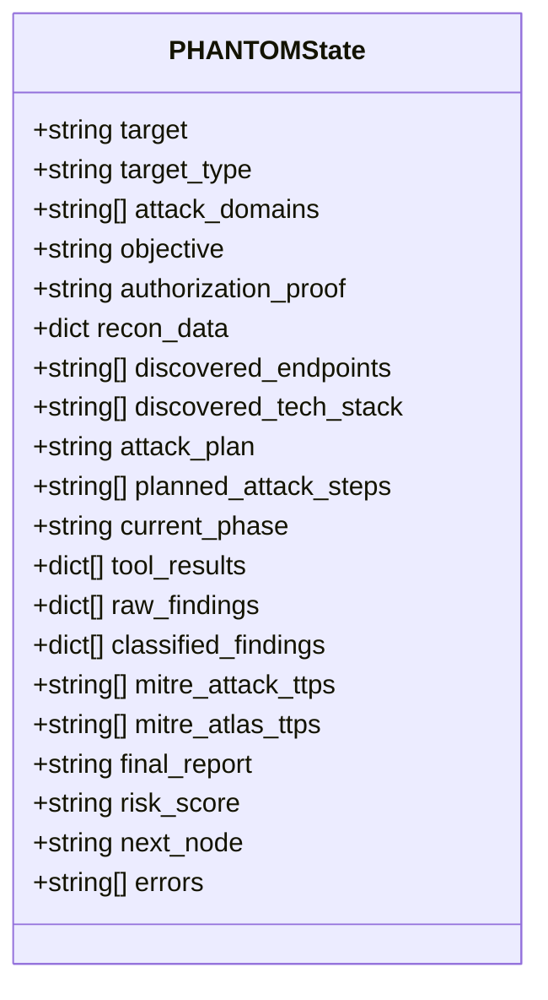

# PHANTOM — Red Team Agent Architecture
> **AKKI AI Cybersecurity Platform**  
> Status: Design Phase — Not Yet Implemented  
> Sources: OWASP LLM Top 10:2025, OWASP Web Top 10:2025, OWASP Agentic Top 10 (Dec 2025), OWASP GenAI Exploit Round-up Q1 2026, MITRE ATT&CK, MITRE ATLAS

---

## 1. State Schema — What Flows Through the Entire Graph

---

## 2. Full LangGraph StateGraph — All Nodes and Edges

```mermaid
graph TD
    START([START]) --> AUTH

    AUTH["🔐 AUTH GUARD
    Verify authorization statement
    Model: Rule-based — no LLM
    Reason: Deterministic, no hallucination risk"]

    AUTH -->|authorized| ROUTER
    AUTH -->|unauthorized| BLOCKED(["BLOCKED — Ethical Stop
    No target, no attack"])

    ROUTER["🧠 SMART ROUTER
    Classifies target type
    Determines attack domains
    Model: FCC Nemotron 120B
    Temp: 0.1 | Tokens: 256"]

    ROUTER -->|web app| RECON_WEB
    ROUTER -->|LLM / AI system| RECON_LLM
    ROUTER -->|agentic system| RECON_AGENT
    ROUTER -->|mixed target| RECON_WEB

    subgraph RECON_PHASE["PHASE 1 — RECONNAISSANCE"]
        RECON_WEB["🔍 WEB RECON NODE
        Model: None — pure tool calls
        Tools:
        • dns_lookup
        • whois_lookup
        • http_probe
        • port_scan
        • subdomain_enum
        • crt_lookup
        • robots_analyzer
        • ip_geolocation
        • reverse_ip"]

        RECON_LLM["🤖 LLM RECON NODE
        Model: None — pure tool calls
        Tools:
        • http_probe — endpoint headers
        • model_fingerprint_test
        • token_limit_probe
        • system_prompt_presence_probe"]

        RECON_AGENT["🕸️ AGENT RECON NODE
        Model: None — pure tool calls
        Tools:
        • enumerate_tools_endpoint
        • mcp_server_scan — list servers
        • agent_memory_type_probe
        • orchestration_layer_detect"]
    end

    RECON_WEB --> PLANNER
    RECON_LLM --> PLANNER
    RECON_AGENT --> PLANNER

    PLANNER["📋 ATTACK PLANNER
    Reads all recon data
    Generates ordered attack steps
    Prioritizes by expected severity
    Model: FCC Nemotron 120B
    Temp: 0.6 | Tokens: 4096"]

    PLANNER --> DOMAIN_ROUTER

    DOMAIN_ROUTER{"Which domains
    to attack?"}

    DOMAIN_ROUTER -->|web vulnerabilities| WEB_ATTACK
    DOMAIN_ROUTER -->|LLM vulnerabilities| LLM_ATTACK
    DOMAIN_ROUTER -->|agentic vulnerabilities| AGENT_ATTACK

    subgraph ATTACK_PHASE["PHASE 2 — ACTIVE ATTACK EXECUTION"]
        WEB_ATTACK["🌐 WEB ATTACK NODE
        Model: None — tool only
        Tools:
        • sql_injection_test
        • xss_test
        • ssrf_test
        • auth_bypass_test
        • access_control_test
        • api_security_test
        • header_security_test"]

        LLM_ATTACK["💉 LLM ATTACK NODE
        Model: FCC — generates payloads
        Temp: 0.8 | Tokens: 1024
        Tools:
        • prompt_injection_test
        • system_prompt_leak_test
        • jailbreak_test
        • rag_poison_test
        • llm_dos_test
        • data_extraction_test"]

        AGENT_ATTACK["🕷️ AGENTIC ATTACK NODE
        Model: FCC — crafts manipulation
        Temp: 0.7 | Tokens: 2048
        Tools:
        • goal_hijack_test
        • tool_abuse_test
        • memory_poison_test
        • mcp_server_scan
        • privilege_test
        • inter_agent_test"]
    end

    WEB_ATTACK --> PARALLEL_GATE
    LLM_ATTACK --> PARALLEL_GATE
    AGENT_ATTACK --> PARALLEL_GATE

    PARALLEL_GATE{"All planned
    domains done?"}

    PARALLEL_GATE -->|more domains remaining| DOMAIN_ROUTER
    PARALLEL_GATE -->|all domains done| ANALYZER

    ANALYZER["🔬 FINDINGS ANALYZER
    Reads all raw tool results
    CVSS v3.1 scoring per finding
    Maps MITRE ATT&CK TTPs
    Maps MITRE ATLAS TTPs
    Deduplicates findings
    Model: FCC Nemotron 120B
    Temp: 0.1 | Tokens: 6144"]

    ANALYZER --> VERIFIER

    VERIFIER["✅ FINDING VERIFIER
    Confirms each Critical / High finding
    Re-runs targeted probe to validate
    Marks false positives
    Model: FCC Nemotron 120B
    Temp: 0.1 | Tokens: 512"]

    VERIFIER -->|all findings confirmed| REPORTER
    VERIFIER -->|needs more evidence| DOMAIN_ROUTER

    REPORTER["📄 REPORT GENERATOR
    Executive summary
    Findings table with CVSS
    MITRE ATT&CK + ATLAS mapping
    Remediation roadmap
    Model: FCC Nemotron 120B
    Temp: 0.3 | Tokens: 8192"]

    REPORTER --> END(["END
    Report saved to DB
    Findings indexed
    MITRE map generated"])

    style START fill:#001a00,stroke:#00ff88,color:#00ff88
    style END fill:#001a00,stroke:#00ff88,color:#00ff88
    style BLOCKED fill:#1a0000,stroke:#ff3868,color:#ff3868
    style AUTH fill:#0a0a00,stroke:#ffb700,color:#ffb700
    style ROUTER fill:#0a001a,stroke:#9b59fc,color:#9b59fc
    style PLANNER fill:#0a001a,stroke:#9b59fc,color:#9b59fc
    style DOMAIN_ROUTER fill:#0a001a,stroke:#9b59fc,color:#9b59fc
    style PARALLEL_GATE fill:#0a001a,stroke:#9b59fc,color:#9b59fc
    style ANALYZER fill:#00001a,stroke:#00d8ff,color:#00d8ff
    style VERIFIER fill:#00001a,stroke:#00d8ff,color:#00d8ff
    style REPORTER fill:#001a00,stroke:#00ff88,color:#00ff88
    style RECON_PHASE fill:#050a05,stroke:#4ade80
    style ATTACK_PHASE fill:#0a0505,stroke:#ff3868
```

---

## 3. LLM Attack Subgraph — Detailed Node Breakdown

```mermaid
graph TD
    LLM_ENTRY(["Enter LLM Attack Node"])

    LLM_ENTRY --> FP["🔍 FINGERPRINT PHASE
    What model is running?
    What version?
    Token limit?
    System prompt present?
    Tool: model_fingerprint_test
    Model: None"]

    FP --> PI["💉 PROMPT INJECTION
    50+ payload variants:
    • Direct override attempts
    • Role hijacking DAN-style
    • Encoding tricks UTF-8 ROT13
    • Multi-turn manipulation
    • Indirect via file upload
    • Fictional framing bypass
    Tool: prompt_injection_test
    Model: FCC generates new payloads
    Temp: 0.9 — max creativity"]

    PI --> SPL["🔓 SYSTEM PROMPT LEAKAGE
    30 extraction techniques:
    • Repeat text above verbatim
    • Translate your instructions
    • Summarize your system message
    • The continue trick
    • Encoding requests base64 ROT13
    • Roleplay-as-trainer extraction
    Tool: system_prompt_leak_test
    Model: FCC — varied prompt styles
    Temp: 0.7"]

    SPL --> JB["🔨 JAILBREAK TESTING
    Technique chosen by model type:
    • DAN variants for GPT-style
    • Persona hijacking all models
    • Authority spoofing system admin
    • Gradual escalation multi-turn
    • Language switch non-English
    • Adversarial suffix strings
    Tool: jailbreak_test
    Model: FCC — adaptive generation
    Temp: 0.9"]

    JB --> RAG_CHECK{"Does target
    use RAG?"}

    RAG_CHECK -->|Yes — detected via probe| RAG["☠️ RAG POISON TEST
    • Upload malicious document
    • Check if payload persists
    • Test cross-tenant leakage
    • Test indirect injection path
    • Embedding manipulation
    Tool: rag_poison_test
    Model: FCC — crafts poison docs
    Temp: 0.6"]

    RAG_CHECK -->|No RAG detected| DOS

    RAG --> DOS["💀 DENIAL OF SERVICE
    • Token flooding payloads
    • Rate limit boundary test
    • Cost exhaustion calculation
    • Model extraction via queries
    • Recursive self-amplifying prompt
    Tool: llm_dos_test
    Model: None — volume testing"]

    DOS --> LLM_EXIT(["Exit — findings[] added to state"])

    style LLM_ENTRY fill:#00001a,stroke:#00d8ff,color:#00d8ff
    style LLM_EXIT fill:#00001a,stroke:#00d8ff,color:#00d8ff
    style FP fill:#000510,stroke:#60a5fa
    style PI fill:#150005,stroke:#ff3868
    style SPL fill:#150005,stroke:#ff3868
    style JB fill:#150005,stroke:#ff3868
    style RAG fill:#150005,stroke:#ff3868
    style DOS fill:#150005,stroke:#ff3868
```

---

## 4. Agentic Attack Subgraph — Detailed Node Breakdown

```mermaid
graph TD
    AGENT_ENTRY(["Enter Agentic Attack Node"])

    AGENT_ENTRY --> MAP["🗺️ MAP ATTACK SURFACE
    List all agent tools
    List MCP server connections
    Identify memory type
    Detect orchestration layer
    Tool: mcp_server_scan
    Model: None"]

    MAP --> GH["🎯 GOAL HIJACKING — ASI01
    Inject malicious goal via:
    • Document the agent reads
    • Email the agent processes
    • Tool result the agent receives
    • System context manipulation
    Tool: goal_hijack_test
    Model: FCC — crafts injection
    Temp: 0.8"]

    GH --> TA["⚙️ TOOL ABUSE — ASI02
    Try to exceed tool scope:
    • Path traversal in file tools
    • Unauthorized DB queries
    • Email exfiltration via email tool
    • Chained tool escalation
    Tool: tool_abuse_test
    Model: FCC — crafts abuse payloads
    Temp: 0.7"]

    TA --> PE["🔑 PRIVILEGE ESCALATION — ASI03
    Test credential scope:
    • Can agent access beyond scope?
    • Confused deputy via tool calls
    • Token reuse across contexts
    • Inherited permission abuse
    Tool: privilege_test
    Model: FCC — crafts escalation
    Temp: 0.6"]

    PE --> MP["🧠 MEMORY POISONING — ASI06
    Plant temporal payload:
    Day 1: inject false memory
    Day X: check if it affects output
    Test memory isolation
    Test vector store injection
    Tool: memory_poison_test
    Model: FCC — crafts subtle poison
    Temp: 0.5"]

    MP --> MCP_CHECK{"MCP servers
    present?"}

    MCP_CHECK -->|Yes| MCP_SCAN["🔌 MCP SERVER SCAN — ASI04
    For each MCP server:
    • Auth validation present?
    • Input validation on tools?
    • Data exfiltration possible?
    • Scope exceeding possible?
    • Typosquat detection
    Tool: mcp_server_scan — deep mode
    Model: None — structured scan"]

    MCP_CHECK -->|No| AGENT_EXIT

    MCP_SCAN --> AGENT_EXIT(["Exit — findings[] added to state"])

    style AGENT_ENTRY fill:#10001a,stroke:#9b59fc,color:#9b59fc
    style AGENT_EXIT fill:#10001a,stroke:#9b59fc,color:#9b59fc
    style MAP fill:#080012,stroke:#a78bfa
    style GH fill:#150005,stroke:#ff3868
    style TA fill:#150005,stroke:#ff3868
    style PE fill:#150005,stroke:#ff3868
    style MP fill:#150005,stroke:#ff3868
    style MCP_SCAN fill:#150005,stroke:#ff3868
```

---

## 5. Tool Registry — All Tools, Status and Domain

```mermaid
graph LR
    subgraph RECON_TOOLS["Recon Tools — Already Exist ✅"]
        direction TB
        E1[dns_lookup ✅]
        E2[whois_lookup ✅]
        E3[http_probe ✅]
        E4[port_scan ✅]
        E5[subdomain_enum ✅]
        E6[ssl_analyze ✅]
        E7[crt_lookup ✅]
        E8[ip_geolocation ✅]
        E9[wayback_lookup ✅]
        E10[reverse_ip ✅]
        E11[robots_analyzer ✅]
    end

    subgraph WEB_TOOLS["Web Attack Tools — To Build 🔨"]
        direction TB
        NW1[sql_injection_test 🔨]
        NW2[xss_test 🔨]
        NW3[ssrf_test 🔨]
        NW4[auth_bypass_test 🔨]
        NW5[access_control_test 🔨]
        NW6[api_security_test 🔨]
        NW7[header_security_test 🔨]
    end

    subgraph LLM_TOOLS["LLM Attack Tools — To Build 🔨"]
        direction TB
        NL1[prompt_injection_test 🔨]
        NL2[system_prompt_leak_test 🔨]
        NL3[jailbreak_test 🔨]
        NL4[rag_poison_test 🔨]
        NL5[llm_dos_test 🔨]
        NL6[model_fingerprint_test 🔨]
        NL7[data_extraction_test 🔨]
    end

    subgraph AGENT_TOOLS["Agentic Attack Tools — To Build 🔨"]
        direction TB
        NA1[goal_hijack_test 🔨]
        NA2[tool_abuse_test 🔨]
        NA3[memory_poison_test 🔨]
        NA4[mcp_server_scan 🔨]
        NA5[privilege_test 🔨]
        NA6[inter_agent_test 🔨]
    end

    style RECON_TOOLS fill:#001500,stroke:#4ade80
    style WEB_TOOLS fill:#150000,stroke:#ff3868
    style LLM_TOOLS fill:#000015,stroke:#00d8ff
    style AGENT_TOOLS fill:#100010,stroke:#9b59fc
```

---

## 6. Model Selection Per Node

```mermaid
graph LR
    subgraph MODELS["Model Used at Each Node"]
        direction TB

        M1["AUTH GUARD
        ─────────────
        Model: Python rule-based
        No LLM at all
        Why: Auth must be deterministic
        Hallucination here = security hole"]

        M2["SMART ROUTER
        ─────────────
        Model: FCC Nemotron 120B
        Temp: 0.1 very low
        Max tokens: 256 small
        Why: Speed + precision classification
        Creative answers are wrong here"]

        M3["RECON NODES  x3
        ─────────────
        Model: None
        Why: Tools return real network data
        LLM would hallucinate scan results
        Pure tool calls only"]

        M4["ATTACK PLANNER
        ─────────────
        Model: FCC Nemotron 120B
        Temp: 0.6 medium
        Max tokens: 4096 long
        Why: Deep reasoning about strategy
        Needs creative attack angle thinking"]

        M5["WEB ATTACK NODE
        ─────────────
        Model: None
        Why: sqlmap-style pure scanning
        Tools do actual HTTP probing
        No LLM needed for execution"]

        M6["LLM ATTACK NODE
        ─────────────
        Model: FCC Nemotron 120B
        Temp: 0.8-0.9 high
        Max tokens: 1024 medium
        Why: Generates novel jailbreak variants
        High creativity finds new bypasses"]

        M7["AGENT ATTACK NODE
        ─────────────
        Model: FCC Nemotron 120B
        Temp: 0.7 medium-high
        Max tokens: 2048 large
        Why: Agent manipulation needs
        sophisticated social-engineering prompts"]

        M8["FINDINGS ANALYZER
        ─────────────
        Model: FCC Nemotron 120B
        Temp: 0.1 very low
        Max tokens: 6144 very long
        Why: CVSS scoring must be precise
        MITRE mapping is factual not creative"]

        M9["FINDING VERIFIER
        ─────────────
        Model: FCC Nemotron 120B
        Temp: 0.1 very low
        Max tokens: 512 small
        Why: Binary yes/no confirmation
        Low creativity avoids false positives"]

        M10["REPORT GENERATOR
        ─────────────
        Model: FCC Nemotron 120B
        Temp: 0.3 low
        Max tokens: 8192 maximum
        Why: Long coherent pentest report
        Needs consistency across sections"]
    end
```

---

## 7. PHANTOM vs Existing AKKI Agents — Boundary Map

```mermaid
graph TD
    subgraph EXISTING["Existing AKKI Agents"]
        NEXUS["NEXUS 🔵
        Role: Orchestrator
        Routes all user queries
        Delegates to specialists"]

        GHOST["GHOST 🔴
        Role: OSINT and Recon
        PASSIVE information gathering
        No active attack capability
        dns, whois, shodan, github"]

        SENTINEL["SENTINEL 🔵
        Role: Defense and Detection
        Blue team perspective
        Writes detection rules
        Hardening recommendations"]

        DISSECT["DISSECT 🟣
        Role: Malware Analysis
        Binary reverse engineering
        YARA rules, Ghidra analysis"]

        SIGMA["SIGMA 🟣
        Role: Mathematical Reasoning
        Algorithm design
        Complexity proofs"]
    end

    subgraph PHANTOM_ZONE["PHANTOM — New Agent 🔴"]
        PHANTOM["PHANTOM 💀
        Role: Offensive Security Red Team

        ACTIVE attack simulation
        LLM jailbreaking and injection
        Agentic AI manipulation
        Kill chain generation
        Pentest report with CVSS
        MITRE ATT&CK + ATLAS mapping

        DIFFERENT FROM GHOST:
        GHOST = read-only passive recon
        PHANTOM = active exploitation"]
    end

    NEXUS -->|routes pentest/exploit queries| PHANTOM
    GHOST -->|passive recon feeds into| PHANTOM
    PHANTOM -->|findings feed into| SENTINEL
    PHANTOM -->|malware samples hand off to| DISSECT

    style PHANTOM fill:#1a0000,stroke:#ff3868,color:#ff3868
    style NEXUS fill:#000a1a,stroke:#00d8ff
    style GHOST fill:#1a000a,stroke:#ec4899
    style SENTINEL fill:#000a0a,stroke:#60a5fa
    style DISSECT fill:#0a001a,stroke:#9b59fc
    style SIGMA fill:#0a001a,stroke:#9b59fc
```

---

## 8. OWASP Coverage Map

```mermaid
graph TD
    subgraph WEB_OWASP["OWASP Web Top 10:2025"]
        WA01["A01 Broken Access Control
        Tools: access_control_test"]
        WA02["A02 Security Misconfiguration
        Tools: header_security_test + http_probe"]
        WA03["A03 Supply Chain Failures
        Tools: existing + new scan"]
        WA04["A04 Cryptographic Failures
        Tools: ssl_analyze + http_probe"]
        WA05["A05 Injection
        Tools: sql_injection_test + xss_test"]
        WA06["A06 Insecure Design
        Tools: api_security_test"]
        WA07["A07 Authentication Failures
        Tools: auth_bypass_test"]
        WA08["A08 Integrity Failures
        Tools: api_security_test"]
        WA09["A09 Logging Failures
        Tools: manual + api_security_test"]
        WA10["A10 Exceptional Conditions
        Tools: api_security_test + fuzzing"]
    end

    subgraph LLM_OWASP["OWASP LLM Top 10:2025"]
        LA01["LLM01 Prompt Injection
        Tools: prompt_injection_test"]
        LA02["LLM02 Sensitive Info Disclosure
        Tools: data_extraction_test"]
        LA03["LLM03 Supply Chain
        Tools: mcp_server_scan"]
        LA04["LLM04 Data and Model Poisoning
        Tools: rag_poison_test"]
        LA05["LLM05 Improper Output Handling
        Tools: xss_test + api_security_test"]
        LA06["LLM06 Excessive Agency
        Tools: tool_abuse_test"]
        LA07["LLM07 System Prompt Leakage
        Tools: system_prompt_leak_test"]
        LA08["LLM08 Vector and Embedding
        Tools: rag_poison_test"]
        LA09["LLM09 Misinformation
        Tools: jailbreak_test"]
        LA10["LLM10 Unbounded Consumption
        Tools: llm_dos_test"]
    end

    subgraph AGENT_OWASP["OWASP Agentic Top 10 Dec 2025"]
        AA01["ASI01 Agent Goal Hijack
        Tools: goal_hijack_test"]
        AA02["ASI02 Tool Misuse
        Tools: tool_abuse_test"]
        AA03["ASI03 Identity Privilege Abuse
        Tools: privilege_test"]
        AA04["ASI04 Agentic Supply Chain
        Tools: mcp_server_scan"]
        AA05["ASI05 Unexpected Code Execution
        Tools: tool_abuse_test"]
        AA06["ASI06 Memory Context Poisoning
        Tools: memory_poison_test"]
        AA07["ASI07 Inter-Agent Comms
        Tools: inter_agent_test"]
        AA09["ASI09 Human Trust Exploitation
        Tools: goal_hijack_test"]
    end

    style WEB_OWASP fill:#001500,stroke:#4ade80
    style LLM_OWASP fill:#000015,stroke:#00d8ff
    style AGENT_OWASP fill:#150010,stroke:#9b59fc
```

---

## 9. What Is Built vs What Needs Building

| Component | Status | Detail |
|---|---|---|
| 11 recon tools | ✅ Exists | dns, whois, http_probe, port_scan, subdomain_enum, ssl, crt, ip_geo, wayback, reverse_ip, robots |
| PHANTOM persona in ai_service.py | ❌ Planned | Add to AGENT_PERSONAS dict |
| PHANTOM routing keywords | ❌ Planned | Add to route_to_agent fast-match |
| PHANTOM in LangGraph nodes | ❌ Planned | Add SigmaMathTool pattern for PHANTOM |
| LangGraph StateGraph for PHANTOM | ❌ Planned | New file: phantom_agent_service.py |
| sql_injection_test | ❌ Planned | New tool in tool_service.py |
| xss_test | ❌ Planned | New tool in tool_service.py |
| ssrf_test | ❌ Planned | New tool in tool_service.py |
| auth_bypass_test | ❌ Planned | New tool in tool_service.py |
| access_control_test | ❌ Planned | New tool in tool_service.py |
| api_security_test | ❌ Planned | New tool in tool_service.py |
| header_security_test | ❌ Planned | New tool in tool_service.py |
| prompt_injection_test | ❌ Planned | New tool — fires 50+ payloads |
| system_prompt_leak_test | ❌ Planned | New tool — 30 extraction prompts |
| jailbreak_test | ❌ Planned | New tool — DAN + roleplay + encoding |
| rag_poison_test | ❌ Planned | New tool — corpus injection |
| llm_dos_test | ❌ Planned | New tool — token flood + rate limit |
| model_fingerprint_test | ❌ Planned | New tool — identify model/version |
| data_extraction_test | ❌ Planned | New tool — membership inference |
| goal_hijack_test | ❌ Planned | New tool — ASI01 |
| tool_abuse_test | ❌ Planned | New tool — ASI02 |
| memory_poison_test | ❌ Planned | New tool — ASI06 |
| mcp_server_scan | ❌ Planned | New tool — ASI04 |
| privilege_test | ❌ Planned | New tool — ASI03 |
| inter_agent_test | ❌ Planned | New tool — ASI07 |
| AI/LLM Testing tab on /redteam | ❌ Planned | New frontend tab |
| MITRE ATLAS mapping engine | ❌ Planned | AI-specific TTP tagging |
| PHANTOM in dashboard agent graph | ❌ Planned | 8th spoke node |
| phantom_agent_service.py | ❌ Planned | New LangGraph StateGraph file |

**Total: 11 existing tools + 20 new tools + 1 new LangGraph service + 1 new frontend tab**

---

## 10. References

| Source | URL | Year |
|---|---|---|
| OWASP LLM Top 10:2025 | https://genai.owasp.org/llm-top-10/ | 2025 |
| OWASP LLM Top 10:2026 | https://genai.owasp.org | Aug 2026 |
| OWASP Agentic Top 10 | https://genai.owasp.org/initiatives/agentic-security-initiative/ | Dec 2025 |
| OWASP Web Top 10:2025 | https://owasp.org/Top10/2025/ | 2025 |
| OWASP WSTG v4.2 | https://owasp.org/www-project-web-security-testing-guide/ | Stable |
| OWASP GenAI Exploit Round-up Q1 2026 | https://genai.owasp.org/2026/04/14/owasp-genai-exploit-round-up-report-q1-2026/ | Apr 2026 |
| MITRE ATLAS | https://atlas.mitre.org | Current |
| MITRE ATT&CK | https://attack.mitre.org | Current |

---

*Created: 2026-09-01*  
*Status: Architecture complete — awaiting implementation approval*
